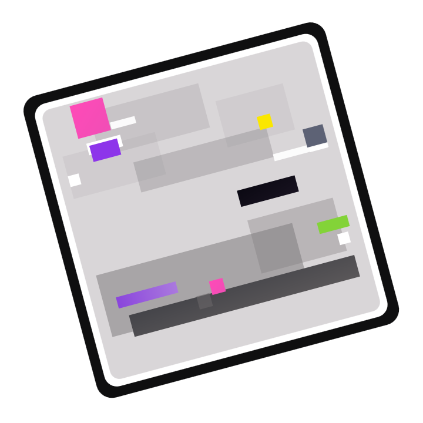
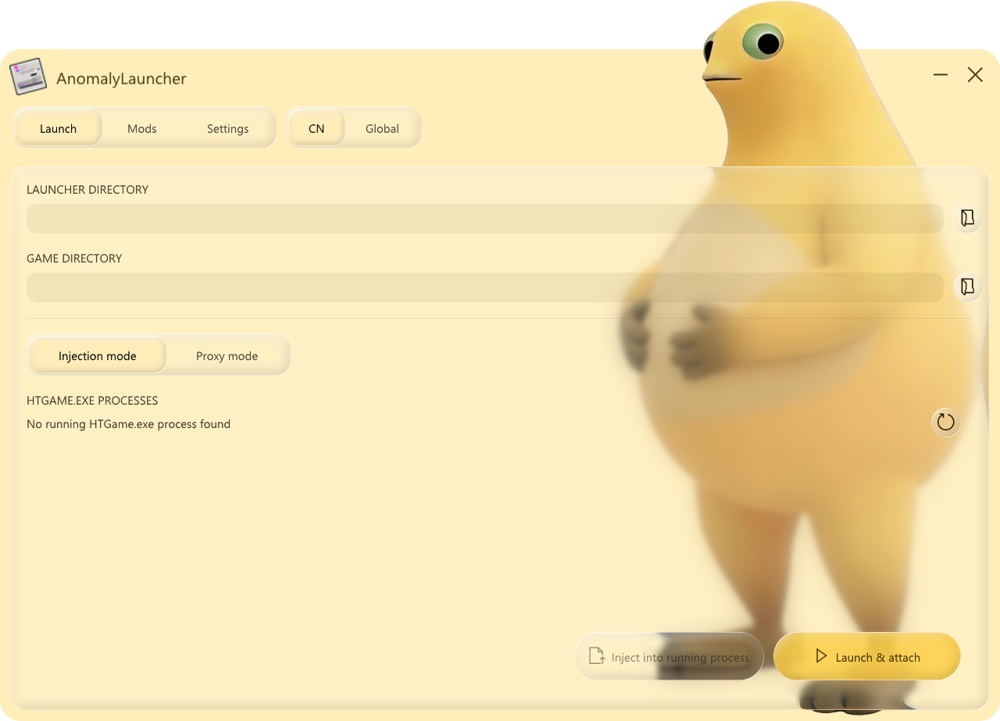

<div align="center">



# Anomaly

**A stable, flexible, and open plugin platform for Neverness to Everness (NTE)**

<a href="https://discord.gg/tfeh8QQ9Vy"></a>

<p align="center">
  <a href="README.md">简体中文</a> · <strong>English</strong>
</p>

<p align="center">
  <a href="docs/en/user-guide/README.md">User guide</a> ·
  <a href="docs/en/user-guide/third-party-plugins.md">Third-party plugins</a> ·
  <a href="docs/en/developer-guide/README.md">Developer guide</a> ·
  <a href="docs/en/api-reference/README.md">API reference</a> ·
  <a href="docs/en/user-guide/quickstart.md">Quickstart</a>
</p>

<p align="center">
  
  
  
  <a href="LICENSE"></a>
</p>



<p align="center">
  <sub>Launcher interface</sub>
</p>

</div>

---

## ⚠️ Disclaimer and risk notice

> [!NOTE]
> Anomaly is a tool **for research, diagnostics, and plugin development**, and it must not be used for cheating.
> Memory reads and writes, hooks, patches, and entity scans modify or read the runtime state of other processes, which may crash the game, corrupt data, or get an account banned.
> Logs, crash dumps, Profile data, and diagnostic bundles **may contain sensitive information**; review and redact them before sharing.

> [!CAUTION]
>
> According to the [Neverness to Everness Fair Play Declaration](https://yh.wanmei.com/news/gamebroad/20260202/260701.html):
>
> Using any third-party tool to undermine fair play is strictly prohibited. We will crack down on the use of cheats, speed hacks, cheat software, macro scripts, and other prohibited tools, including but not limited to unattended automation, skill acceleration, invincibility, teleportation, and modifying game data. Once verified, depending on the severity and number of violations, we will take measures including but not limited to reclaiming ill-gotten gains, freezing game accounts, and permanently banning game accounts.
>
> **You should fully understand and voluntarily accept all risks that may arise from using this tool.**

## 🧾 Open-source license

This project is distributed under the [**GNU Affero General Public License v3.0 (AGPL-3.0-only)**](LICENSE). Third-party components and their respective licenses are listed in [`NOTICE`](NOTICE) and `third_party/licenses/`.

## ❤️ Support us

If Anomaly is useful to you, you can support the project's continued maintenance:

<p>
  <a href="https://afdian.com/a/bananachicken"></a>
  <a href='https://ko-fi.com/L1F621P7S2' target='_blank'></a>
</p>

## ✨ Features

- 🚀 **Installation and updates**: extract the runtime package and attach the launcher to the game with inject mode, which writes nothing into the game directory; proxy mode is still available, and later versions update from inside the launcher.
- 🪟 **In-game management UI**: press `Insert` to open the Chinese or English UI and manage plugin enablement, disabling, reload, and settings in one place.
- 🌐 **Third-party plugin downloads**: browse and install community plugins under **Plugins > Available**, upgrade them under **Updates**, and add trusted plugin sources yourself.
- 🔥 **Hot mod loading**: in hot mode, enabling, swapping, or removing a mod takes effect immediately — appearances are refreshed in place, resources that cannot be rebound fall back to the **Mod Manager** plugin's world reload, and the game never restarts.
- 🔌 **Practical built-in plugins**: the package ships 35 user-facing plugins covering coordinates and health, entity ESP, combat statistics, camera and blur removal, skins and model replacement, vehicles, scene switching, audio replacement, and automation scripts — all disabled by default and enabled on demand.
- 🤖 **Automation tasks**: Resource Auto Pickup, Combat Resource Points, Clone Enter, WalletCollector, and 999 Nights Script can teleport, fight, or pick up automatically, and you can stop them at any time from the plugin window.
- 🧩 **Open plugin framework**: a pure C ABI v1 SDK and unified V1 services, so a plugin project needs neither the runtime source nor the C++ ABI.
- 🔍 **Memory analysis and developer tools**: inspect process modules, PE sections, and memory regions, with a byte signature scan, an offline TestHost, and other developer tools.

### 🔌 Built-in plugins

The runtime package ships **35** user-facing built-in plugins, all disabled by default and enabled on demand. Each plugin is described in detail under [built-in plugins](docs/en/user-guide/built-in-plugins.md).

**UI and information**

| Plugin | Purpose |
| --- | --- |
| **Coordinate Display** | Player and camera coordinates, session state, and snapshot sampling metrics |
| **Entity ESP** | Configurable 2D/3D bounding boxes and labels for NTE entities |
| **Health Display** | Independent health bars with current/max HP for monsters and characters, adjustable range, size, and text |
| **NTE Combat Tracker** | FF14-style DPS panel: capture runs inside the plugin, rendering in a bundled standalone overlay process |
| **Status Bar** | Liquid-glass status bar: frame rate, 1% low, time, CPU/memory/GPU load, clocks, temperature, and power |
| **UI Buttons** | Lists in-game UI buttons by clickability and clicks them through the UI service |

**Visuals and appearance**

| Plugin | Purpose |
| --- | --- |
| **Camera Blur Fix** | Removes camera fading for the player, NPCs, and crowds, including pitch-based fading and close-range hiding |
| **Camera Tools** | View distance and FOV adjustment, forced camera rotation blocking, free camera, and optional scene loading around it |
| **Model Scale** | Rescales the local character mesh without touching movement or collision |
| **SkinChanger Lite** | Character accessories, glider, awakened appearance, custom license plates, and the current vehicle's appearance |
| **NaiLong** | Engine-native model replacement for the player and nearby NPCs with 36-bone source-rig skinning, restored when out of range |
| **Jelly** | Keeps characters, vehicles, and dynamic models in view squashing and stretching, with adjustable strength, frequency, rest interval, and spin |
| **Better Pose** | Animation rate, pause, and displacement scale, joint pose editing, MMD motion and camera import, and Blender skeleton linking |
| **Character Studio** | Spawns local character models from a complete catalog with Chinese names, unlimited duplicates, idle loops, and per-model move/destroy |
| **Mod Manager** | Mod toggles, classification, in-place appearance refresh, and world reload |
| **Custom UID** | Custom UID, colors, and dynamic effects on the client UI, without touching account data |

**Combat and summoning**

| Plugin | Purpose |
| --- | --- |
| **Pink Paw Heist ESP** | Loot and extraction points with value filters, bank loop pickup, run limits, and entry animation skip |
| **Quick Ultimate** | Hold Alt+1..4 to switch characters and keep sending Q; release to stop |
| **Summon Lab** | Spawns monsters and playable characters with custom attributes, hostile/pet modes, group battles, and unified management |
| **NPC Summon** | Lists the NPC classes actually running in the world, filters them by keyword, spawns one in front of you, and clears your own spawns |
| **Training Dummy** | Spawns dummies through the character's own summon path, driven entirely from a panel |

**Vehicles and scenes**

| Plugin | Purpose |
| --- | --- |
| **Vehicle Control** | Vehicle catalog, plain or customized summoning, speed/torque/wheel-friction tuning, and full durability for the current land vehicle |
| **Scene Loader** | Lists the game's scenes and switches through the game's own entrances, including in-scene entrances, world return, and data layers |
| **Deserted** | Stops crowd and traffic spawning without affecting stationary NPCs |
| **HiFi Vehicle Music** | Replaces in-vehicle music with a local lossless library over WASAPI exclusive/shared, DirectSound, or ASIO |
| **Better TV** | Replaces the residence TV video with a local clip or a Bilibili link; memory only, no game files written |

**Automation**

| Plugin | Purpose |
| --- | --- |
| **Resource Auto Pickup** | Reads the resource point table and picks up EXP books, gifts, furniture, food, wallets, Oracle stones, and more |
| **Combat Resource Points** | Visits combat chests and Anomaly furniture material points one by one, fights, then marks and caches them locally |
| **Clone Enter** | Enters a dungeon by dungeon and difficulty, fights, claims rewards, exits, and optionally loops |
| **WalletCollector** | Scans wallet spawn points, plans a route for the target count, and collects the wallets automatically |
| **Night 999** | Loops enemy farming in Crimson Dragon Castle for the configured number of rounds: camp respawn plus automatic combat at two fight points |
| **AutoFish** | Automatic casting, hooking, and reeling with continuous fishing, bait restocking, and selling past a threshold |
| **AutoTaxi** | Completes taxi orders automatically and shows the completion count the game confirms |
| **AutoClaw** | Picks a doll in the active machine, auto-submits one capture after you pay a round, and shows the server's response |
| **Free Fly** | WASD flight and noclip with Space to ascend and Ctrl to descend; the toggle hotkey is configurable |

### 🌐 Third-party plugins

Press `Insert` to open **Plugins**, and you can handle day-to-day third-party plugin management:

| Page | What it is for |
| --- | --- |
| **Available** | Search for plugins and download and install them |
| **Updates** | See new versions of installed plugins |
| **Installed** | Enable, disable, reload, or uninstall plugins |
| **Third-party plugins** | Add, disable, or remove plugin sources |

The runtime package ships one enabled plugin source; the actual address is defined by `Anomaly\plugin-repositories.json`. You can also add your own trusted HTTPS plugin sources in the UI. See [third-party plugins](docs/en/user-guide/third-party-plugins.md) for the full steps.

> [!WARNING]
> Third-party plugins are native DLLs that run inside the game process, not sandboxed scripts. The plugin catalog and plugin packages currently carry no publisher signature; Anomaly validates the download address, ZIP paths, Manifest, version, and game and API match, but these checks cannot prove that a plugin is safe. Install only plugins from sources and authors you trust.

## 🚀 Quickstart

> [!NOTE]
> Regular users do not need to build from source. Download `Anomaly-<version>-runtime.zip`, extract it completely, run the bundled `AnomalyLauncher.exe`, then confirm the paths on the **Launch** page and attach to the game with **Inject mode** — the default recommendation, which writes nothing into the game directory.

1. Download and **fully extract** the runtime package (do not run it from inside the archive, and do not take only `AnomalyLauncher.exe`); see [installation and updates](docs/en/user-guide/installation.md).
2. On the launcher's **Launch** page, confirm the two paths at the top: **Launcher directory** points at the official `NTELauncher.exe`, and **Game directory** points at the folder that directly contains `HTGame.exe`. Use the button on the right to repick either one.
3. Keep the default **Inject mode** and pick the button that matches the game's current state:
   - Game not running: click **Launch and attach**; the launcher starts the official launcher, waits for the `HTGame.exe` it just created, then maps the core in.
   - Game already running: click **Inject into running process**, which maps the core only and does not restart the game.
   - Want the proxy inside the game directory so a shortcut always brings Anomaly along: switch to **Proxy mode** and click **Install**. The two modes are exclusive — while the proxy is enabled the inject actions are disabled, so disable it on the proxy page first.
4. Start the game as usual and press `Insert` to open the management UI.
5. Plugins: enable built-in plugins under **Plugins > Installed**; install community plugins from **Plugins > Available** and enable them under **Installed**; upgrade under **Plugins > Updates**.


Building from source (developers):

```powershell
.\build.cmd
```

`build.cmd` is a thin wrapper around the only supported build path (CMake preset `windows-vs2022` plus `windows-relwithdebinfo`); configuring then building produces a directly deployable runtime package. By default it builds only Runtime, Tools, and SDK; enable developer fixtures and PDBs on demand with `build.cmd fixtures|symbols`. See [building from source](docs/en/developer-guide/building.md) for details.

## 📚 Documentation

| Documentation set | Audience | Contents |
| --- | --- | --- |
| [📘 User guide](docs/en/user-guide/README.md) | Users | Installation, built-in and third-party plugins, updates, configuration, and troubleshooting |
| [🛠️ Developer guide](docs/en/developer-guide/README.md) | Plugin authors and framework contributors | Plugin development and distribution, building from source, architecture, and the contribution workflow |
| [📑 API reference](docs/en/api-reference/README.md) | Plugin authors | The complete pure C ABI v1: lifecycle, all service tables, Manifest, and capability |

Project-level references: [architecture overview](docs/en/developer-guide/architecture.md) (module boundaries and dependency direction) and [`AGENTS.md`](AGENTS.md) (collaboration conventions).

## ❓ FAQ

> [!TIP]
> For more questions, see [troubleshooting and FAQ](docs/en/user-guide/troubleshooting.md).

- **`Insert` does nothing?** Change the main window hotkey under the launcher's **Settings → Startup settings** by pressing a key; you can also edit `[Platform] ToggleKey` in `anomaly.ini` (a Win32 virtual-key code, default `45` = `VK_INSERT`).
- **Inject mode buttons stay disabled?** The inject actions are disabled while the proxy is enabled: go to **Launch → Proxy mode**, click **Disable**, and exit the game first. **Launch and attach** only works when no `HTGame.exe` is running; if the game is already running, use **Inject into running process**.
- **No plugins under Available?** Go to **Plugins > Third-party plugins** and confirm that both the master switch and the plugin source are enabled, then return to **Available** and click refresh. See [third-party plugins](docs/en/user-guide/third-party-plugins.md) for details.
- **Third-party plugin installation failed?** The usual causes are an unavailable download address, a wrong ZIP structure, or a plugin ID, version, game, or API that does not match the catalog. The UI shows the failure reason, and the detailed record is in `Anomaly\anomaly-platform.log`.
- **Plugin failed to load?** Confirm that it is a directory package containing `manifest.json`; root-level DLLs and directories without a Manifest are not loaded.
- **Coordinates, entities, or another feature shows as unavailable?** This usually means the active Profile lacks the required signature, or symbol or layout validation did not pass. See [NTE Build Profile](docs/en/user-guide/nte-profiles.md).

## 💬 Community

**Discord:** [https://discord.gg/tfeh8QQ9Vy](https://discord.gg/tfeh8QQ9Vy)

The Discord server is where releases land first and where install problems actually get solved, usually faster than a GitHub issue because someone can read your log in real time.

> [!TIP]
> When you ask for help, post the runtime version, the plugin (or "built-in"), your NTE Build Profile, and the relevant log lines. A report with the log attached usually gets an answer in one round instead of five.

## 💡 Notes

- Only **Windows x64** is supported. Running plugins needs only the installed SDK, not the runtime source.
- Real-time process tools (`write` / `patch` / `protect` / `alloc` / `free`) modify the target process and are not part of normal use; use them **only on your own test processes**.
- The main repository has exactly **one** supported build path; do not create temporary CMake / NMake build trees.

## 💻 Development guide

- [Building from source](docs/en/developer-guide/building.md) — environment, `build.cmd`, validation, and release packaging
- [Architecture overview](docs/en/developer-guide/architecture.md) — thread domains, ServiceGraph, ownership, and the ABI boundary
- [Plugin development](docs/en/developer-guide/plugin-development.md) — SDK, Manifest, capability, lifecycle, and hot reload
- [Distributing third-party plugins](docs/en/developer-guide/plugin-distribution.md) — packaging a ZIP, configuring the online plugin source JSON, publishing, and validation
- [Contributing guide](docs/en/developer-guide/contributing.md) — workflow, commit conventions, code boundaries, and validation gates

To start a standalone plugin repository, use the [Anomaly Plugin Template](https://github.com/AnomalyNTE/Anomaly-Plugin-Template); the repository also contains four standalone SDK examples in [`examples/`](examples/README.md).

## ❤️ Credits

Anomaly uses the following open-source components at runtime or in its distribution packages (full license texts in [`NOTICE`](NOTICE) and `third_party/licenses/`):

**Runtime and UI**

- [Dear ImGui](https://github.com/ocornut/imgui) — embedded graphical UI
- [MinHook](https://github.com/TsudaKageyu/minhook), including Hacker Disassembler Engine 32/64 — function hooking and instruction-length decoding
- [nlohmann/json](https://github.com/nlohmann/json) and [JSON schema validator](https://github.com/pboettch/json-schema-validator) — JSON parsing and Profile / Manifest Schema validation
- [BLAKE3](https://github.com/BLAKE3-team/BLAKE3) — content hashing for mod compatibility containers and mod fingerprints
- [miniz](https://github.com/richgel999/miniz) — plugin package ZIP parsing
- [Noto Sans CJK](https://github.com/notofonts/noto-cjk) — Chinese and English UI font

**Audio and decoding**

- [miniaudio](https://github.com/mackron/miniaudio) and [RtAudio](https://github.com/thestk/rtaudio), including the ASIO SDK — format decoding and WASAPI / DirectSound / ASIO output for in-vehicle music
- [Monkey's Audio SDK](https://www.monkeysaudio.com/) and [dsd2pcm](https://github.com/GiangLH/dsd2pcm) — APE and DSD decoding

**Launcher**

- [libarchive](https://github.com/libarchive/libarchive), [XZ Utils liblzma](https://github.com/tukaani-project/xz), and [zlib](https://zlib.net/) — mod and plugin archive extraction

**Inspiration**

- [Dalamud](https://github.com/goatcorp/Dalamud) — source of inspiration
