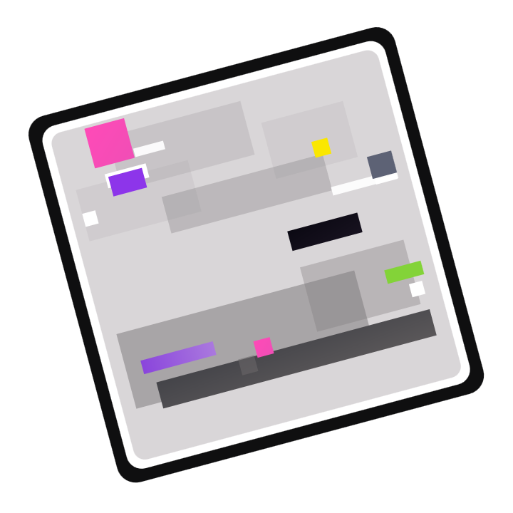

<div align="center">



# Anomaly

**A stable, flexible, and open plugin platform for Neverness to Everness (NTE)**

<p align="center">
  <a href="README.md">简体中文</a> · <strong>English</strong>
</p>

<p align="center">
  <a href="docs/en/user-guide/README.md">User guide</a> ·
  <a href="docs/en/user-guide/third-party-plugins.md">Third-party plugins</a> ·
  <a href="docs/en/developer-guide/README.md">Developer guide</a> ·
  <a href="docs/en/api-reference/README.md">API reference</a> ·
  <a href="docs/en/user-guide/quickstart.md">Quickstart</a>
</p>

<p align="center">
  
  
  
  <a href="LICENSE"></a>
</p>

</div>

---

## ⚠️ Disclaimer and risk notice

> [!NOTE]
> Anomaly is a tool **for research, diagnostics, and plugin development**, and it must not be used for cheating.
> Memory reads and writes, hooks, patches, and entity scans modify or read the runtime state of other processes, which may crash the game, corrupt data, or get an account banned.
> Logs, crash dumps, Profile data, and diagnostic bundles **may contain sensitive information**; review and redact them before sharing.

> [!CAUTION]
>
> According to the [Neverness to Everness Fair Play Declaration](https://yh.wanmei.com/news/gamebroad/20260202/260701.html):
>
> Using any third-party tool to undermine fair play is strictly prohibited. We will crack down on the use of cheats, speed hacks, cheat software, macro scripts, and other prohibited tools, including but not limited to unattended automation, skill acceleration, invincibility, teleportation, and modifying game data. Once verified, depending on the severity and number of violations, we will take measures including but not limited to reclaiming ill-gotten gains, freezing game accounts, and permanently banning game accounts.
>
> **You should fully understand and voluntarily accept all risks that may arise from using this tool.**

## 🧾 Open-source license

This project is distributed under the [**GNU Affero General Public License v3.0 (AGPL-3.0-only)**](LICENSE). Third-party components and their respective licenses are listed in [`NOTICE`](NOTICE) and `third_party/licenses/`.

## ✨ Features

- 🚀 **Installation and updates**: extract the runtime package and open the launcher, then select the directory containing `HTGame.exe` to install; later versions update in place.
- 🪟 **In-game management UI**: press `Insert` to open the Chinese or English UI and manage plugin enablement, disabling, reload, and settings in one place.
- 🌐 **Third-party plugin downloads**: browse and install community plugins under **Plugins > Available**, upgrade them under **Updates**, and add trusted plugin sources yourself.
- 🔌 **Practical built-in plugins**: the package ships Coordinate Display, Entity ESP, Pink Paw Heist ESP with bank loop, vehicle control, 999 Nights auto farming, a combat damage dashboard, Custom UID, camera tools with blur removal, skeleton pose adjustment, resource point auto pickup, combat resource points, automatic instance runs, and WalletCollector — all disabled by default and enabled on demand.
- 🎥 **Camera tools**: Camera Tools folds draw distance and view FOV changes plus the free camera into a single camera hook, so two camera plugins enabled at once no longer conflict.
- 🤖 **Automation tasks**: Resource Auto Pickup, Combat Resource Points, Clone Enter, WalletCollector, and 999 Nights Script can teleport, fight, or pick up automatically, and you can stop them at any time from the plugin window.
- 🧭 **Status and troubleshooting**: plugin incompatibility, missing dependencies, or a Profile that is not ready are reported with the reason directly; full status is available under **Diagnostics** and in the logs.
- 🧩 **Open plugin framework**: a pure C ABI v1 SDK and unified V1 services, so a plugin project needs neither the runtime source nor the C++ ABI.
- 🔄 **Complete plugin lifecycle**: Manifest, SemVer, dependency and capability validation, package validation, file-watch hot reload, and rollback on failure.
- 🧬 **UE5 / NTE adaptation**: validated UE5 symbol resolution plus high-level services for session, player, camera, entity, map landmarks, teleport, and vehicles; a feature degrades when its conditions are not met.
- 🔍 **Memory analysis and developer tools**: inspect process modules, PE sections, and memory regions, with a byte signature scan, an offline TestHost, and other developer tools.
- 🛡️ **Fault isolation**: a single failing plugin is isolated, and a failed new version rolls back to the previous generation automatically.

### 🔌 Built-in plugins

The runtime package contains the following common built-in plugins (see [built-in plugins](docs/en/user-guide/built-in-plugins.md) for the full description):

| Plugin | Purpose |
| --- | --- |
| **Coordinate Display** | Shows player coordinates, session state, and sampling metrics |
| **Entity ESP** | Draws entity bounding boxes and labels |
| **Deserted** | Prevents pedestrian and traffic spawns without affecting stationary NPCs |
| **Pink Paw Heist ESP** | Shows Pink Paw Heist loot and extraction points, with value filtering, bank loop pickup, count limits, and entry animation skip |
| **NTE Vehicle (developer mode)** | Inspect, summon, and tune the current vehicle: vehicle catalog, display name, speed, torque, wheel friction, and non-player vehicle control |
| **999 Nights Script** | Loops enemy farming in Red Dragon Castle in 999 Nights for a set number of runs: camp respawn and automatic combat at two combat points |
| **NTE Damage Dashboard** | Live statistics for player damage, hits, crits, team and skill distribution, and recent hit records |
| **Custom UID** | Sets a custom UID for the client UI |
| **Skin Swapper Lite** | Character accessories, glider, awakened appearance previews, and custom license plates |
| **Camera Tools** | Increases draw distance, adjusts view FOV and the free camera view, and optionally loads the scene at the free camera position |
| **CameraBlurFix** | Removes the blur effect on the character when the camera tilts up |
| **Better Pose** | Adjusts animation speed, pause, and displacement scale, edits joint poses, and imports MMD motions and cameras, with playback speed, height correction, XYZ motion ratios, per-part amplitude, per-joint calibration, limb extension/landing points, and manual A/T-pose skeleton calibration |
| **HiFi Vehicle Music** | Replaces in-vehicle music with a local lossless library, with WASAPI, DirectSound, and ASIO support |
| **Quick Ultimate** | Hold Alt+1/2/3/4 to switch characters automatically and keep sending Q; release to stop |
| **Resource Auto Pickup** | Reads the resource point table and picks up resource points such as character EXP books, furniture, food, and wallets by teleport or pathing |
| **Combat Resource Points** | Visits combat chests and Anomaly furniture material points one by one, fights automatically, then marks and caches them locally |
| **Clone Enter** | Enters an instance by instance and difficulty, fights, claims rewards, and exits, with optional looping |
| **AutoFish** | Casts, reels, and plays fish automatically, with continuous fishing, bait restocking, and selling fish past a threshold |
| **Free Fly** | Free flight and noclip: WASD to move, Space to ascend, Ctrl to descend, direction follows the view, and the toggle hotkey is configurable |
| **WalletCollector** | Scans wallet spawn points, plans a route for the target count, and picks them up automatically |
| **Model Scale** | Scales the local character mesh without affecting movement or collision |
| **UI Buttons** | Lists clickable game UI buttons and clicks them through the UI service |
| **Jelly** | Keeps characters, vehicles, and dynamic models in view squashing and stretching, with adjustable strength, frequency, stop interval, and self-rotation |

Developer mode also shows debug plugins such as **Teleport**, **DLL Loader**, and **Time Accel**; the complete package catalog is in [`plugins/README.md`](plugins/README.md).

### 🌐 Third-party plugins

Press `Insert` to open **Plugins**, and you can handle day-to-day third-party plugin management:

| Page | What it is for |
| --- | --- |
| **Available** | Search for plugins and download and install them |
| **Updates** | See new versions of installed plugins |
| **Installed** | Enable, disable, reload, or uninstall plugins |
| **Third-party plugins** | Add, disable, or remove plugin sources |

The runtime package ships one enabled plugin source; the actual address is defined by `Anomaly\plugin-repositories.json`. You can also add your own trusted HTTPS plugin sources in the UI. See [third-party plugins](docs/en/user-guide/third-party-plugins.md) for the full steps.

> [!WARNING]
> Third-party plugins are native DLLs that run inside the game process, not sandboxed scripts. The plugin catalog and plugin packages currently carry no publisher signature; Anomaly validates the download address, ZIP paths, Manifest, version, and game and API match, but these checks cannot prove that a plugin is safe. Install only plugins from sources and authors you trust.

## 🚀 Quickstart

> [!NOTE]
> Regular users do not need to build from source. Download `Anomaly-<version>-runtime.zip`, extract it completely, run the bundled `AnomalyLauncher.exe`, then on the **Proxy install** page select the directory containing `HTGame.exe` and click **Install**.

1. Download and install the runtime package; see [installation and updates](docs/en/user-guide/installation.md) for the steps.
2. Start the game as usual and press `Insert` to open the management UI.
3. To use a built-in plugin, open **Plugins > Installed**, select the plugin, and enable it.
4. To install a community plugin, open **Plugins > Available** and click **Install**; then return to **Installed** and enable it.
5. When a plugin has a new version, upgrade it under **Plugins > Updates**.

Building from source (developers):

```powershell
.\build.cmd
```

`build.cmd` is a thin wrapper around the only supported build path (CMake preset `windows-vs2022` plus `windows-relwithdebinfo`); configuring then building produces a directly deployable runtime package. By default it builds only Runtime, Tools, and SDK; enable developer fixtures and PDBs on demand with `build.cmd fixtures|symbols`. See [building from source](docs/en/developer-guide/building.md) for details.

## 📚 Documentation

| Documentation set | Audience | Contents |
| --- | --- | --- |
| [📘 User guide](docs/en/user-guide/README.md) | Users | Installation, built-in and third-party plugins, updates, configuration, and troubleshooting |
| [🛠️ Developer guide](docs/en/developer-guide/README.md) | Plugin authors and framework contributors | Plugin development and distribution, building from source, architecture, and the contribution workflow |
| [📑 API reference](docs/en/api-reference/README.md) | Plugin authors | The complete pure C ABI v1: lifecycle, all service tables, Manifest, and capability |

Project-level references: [architecture overview](docs/en/developer-guide/architecture.md) (module boundaries and dependency direction) and [`AGENTS.md`](AGENTS.md) (collaboration conventions).

## ❓ FAQ

> [!TIP]
> For more questions, see [troubleshooting and FAQ](docs/en/user-guide/troubleshooting.md).

- **`Insert` does nothing?** Change the **Main window hotkey** under **Anomaly Launcher > Startup settings** by pressing a key; you can also edit `[Platform] ToggleKey` in `anomaly.ini` (a Win32 virtual-key code, default `45` = `VK_INSERT`).
- **No plugins under Available?** Go to **Plugins > Third-party plugins** and confirm that both the master switch and the plugin source are enabled, then return to **Available** and click refresh. See [third-party plugins](docs/en/user-guide/third-party-plugins.md) for details.
- **Third-party plugin installation failed?** The usual causes are an unavailable download address, a wrong ZIP structure, or a plugin ID, version, game, or API that does not match the catalog. The UI shows the failure reason, and the detailed record is in `Anomaly\anomaly-platform.log`.
- **Plugin failed to load?** Confirm that it is a directory package containing `manifest.json`; root-level DLLs and directories without a Manifest are not loaded.
- **Coordinates, entities, or another feature shows as unavailable?** This usually means the active Profile lacks the required signature, or symbol or layout validation did not pass. See [NTE Build Profile](docs/en/user-guide/nte-profiles.md).
- **Does it conflict with RE-UE4SS?** The proxy file name is also `dwmapi.dll`, so the two cannot share one directory; Anomaly is a separate entry point and does not load `UE4SS.dll`.

## 💡 Notes

- Only **Windows x64** is supported. Running plugins needs only the installed SDK, not the runtime source.
- Real-time process tools (`write` / `patch` / `protect` / `alloc` / `free`) modify the target process and are not part of normal use; use them **only on your own test processes**.
- The main repository has exactly **one** supported build path; do not create temporary CMake / NMake build trees.

## 💻 Development guide

- [Building from source](docs/en/developer-guide/building.md) — environment, `build.cmd`, validation, and release packaging
- [Architecture overview](docs/en/developer-guide/architecture.md) — thread domains, ServiceGraph, ownership, and the ABI boundary
- [Plugin development](docs/en/developer-guide/plugin-development.md) — SDK, Manifest, capability, lifecycle, and hot reload
- [Distributing third-party plugins](docs/en/developer-guide/plugin-distribution.md) — packaging a ZIP, configuring the online plugin source JSON, publishing, and validation
- [Contributing guide](docs/en/developer-guide/contributing.md) — workflow, commit conventions, code boundaries, and validation gates

To start a standalone plugin repository, use the [Anomaly Plugin Template](https://github.com/AnomalyNTE/Anomaly-Plugin-Template); the repository also contains four standalone SDK examples in [`examples/`](examples/README.md).

## ❤️ Credits

Anomaly uses the following open-source components at runtime or in its distribution packages:

- [Dear ImGui](https://github.com/ocornut/imgui) — embedded graphical UI
- [MinHook](https://github.com/TsudaKageyu/minhook) — function hook backend
- [nlohmann/json](https://github.com/nlohmann/json) and [JSON schema validator](https://github.com/pboettch/json-schema-validator) — JSON and Schema validation
- [Noto Sans CJK](https://github.com/notofonts/noto-cjk) — Chinese and English UI font
- [Dalamud](https://github.com/goatcorp/Dalamud) — source of inspiration
