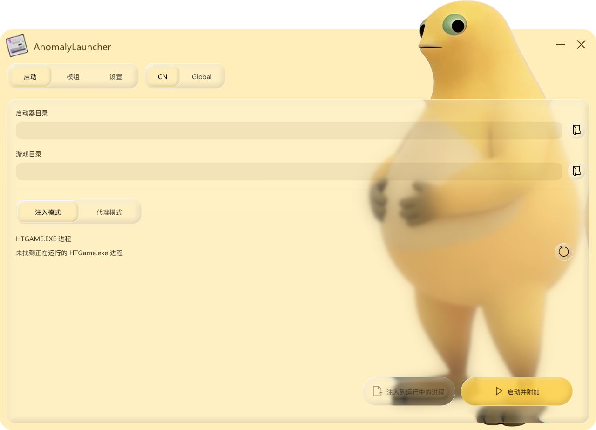

<div align="center">


# Anomaly 异象

**稳定、灵活、开放的《异环》插件平台**

qq交流群: 1037114140

<a href="https://discord.gg/tfeh8QQ9Vy"></a>

<p align="center">
  <strong>简体中文</strong> · <a href="README.en.md">English</a>
</p>

<p align="center">
  <a href="docs/user-guide/README.md">用户文档</a> ·
  <a href="docs/user-guide/third-party-plugins.md">第三方插件</a> ·
  <a href="docs/developer-guide/README.md">开发者文档</a> ·
  <a href="docs/api-reference/README.md">API 参考</a> ·
  <a href="docs/user-guide/quickstart.md">快速上手</a>
</p>

<p align="center">
  
  
  
  <a href="LICENSE"></a>
</p>



<p align="center">
  <sub>启动器界面</sub>
</p>

</div>

---

## ⚠️ 免责声明与风险提示

> [!NOTE]
> Anomaly 是**面向研究、诊断与插件开发**的工具，不得用于作弊行为。
> 内存读写、hook、patch、实体扫描会修改或读取其他进程的运行状态，可能导致游戏崩溃、数据损坏或账号封禁。
> 日志、崩溃转储、Profile 数据与诊断包**可能包含敏感信息**，分享前请审查并脱敏。

> [!CAUTION]
>
> 根据[《异环》公平游戏宣言](https://yh.wanmei.com/news/gamebroad/20260202/260701.html)：
>
> 严禁使用任何第三方工具破坏游戏公平性。我们将严厉打击使用外挂、加速器、作弊软件、宏脚本等非法工具的行为，这些行为包括但不限于自动挂机、技能加速、无敌模式、瞬移、修改游戏数据等操作。一经查实，我们将视违规严重程度及违规次数，采取包括但不限于扣除违规收益、冻结游戏账号、永久封禁游戏账号等措施。
>
> **您应充分了解并自愿承担使用本工具可能带来的所有风险。**

## 🧾 开源许可

本项目以 [**GNU Affero General Public License v3.0（AGPL-3.0-only）**](LICENSE) 分发，第三方组件及其各自的许可证见 [`NOTICE`](NOTICE) 与 `third_party/licenses/`。

## ❤️ 支持我们

如果 Anomaly 对你有帮助，欢迎通过下面的方式支持项目继续维护：

<p>
  <a href="https://afdian.com/a/bananachicken"></a>
  <a href='https://ko-fi.com/L1F621P7S2' target='_blank'></a>
</p>

## ✨ 功能介绍

- 🚀 **安装与更新**：解压 Runtime，打开启动器用注入模式直接附加到游戏，不往游戏目录写任何文件；也保留代理模式，后续版本能在启动器里直接更新。
- 🪟 **游戏内管理界面**：按 `Insert` 呼出中文或英文界面，统一管理插件的启用、停用、重载和设置。
- 🌐 **第三方插件下载**：在 **Plugins > 可用** 中浏览和安装社区插件，在 **更新** 中升级，也可以自行添加可信插件源。
- 🔥 **模组热加载**：热加载模式下启用、替换或卸载 Mod 都即时生效，外观原地刷新，无法原地重绑的资源用 Mod 管理插件的「重新加载世界」兜底，全程不需要重启游戏。
- 🔌 **实用内建插件**：随包提供 35 个面向用户的内建插件，覆盖坐标与血量显示、实体 ESP、战斗统计、相机与反虚化、换肤与模型替换、载具、场景切换、音频替换与各类自动化脚本，全部默认关闭，按需启用。
- 🤖 **自动化任务**：Resource Auto Pickup、Combat Resource Points、Clone Enter、WalletCollector 与 999夜脚本支持自动传送、战斗或拾取，并可在插件窗口中随时停止。
- 🧩 **开放插件框架**：提供纯 C ABI v1 SDK 和统一 V1 服务，插件工程无需依赖 Runtime 源码或 C++ ABI。
- 🔍 **内存分析与开发工具**：支持查看进程模块、PE 节区和内存区域，并提供字节签名扫描、离线 TestHost 等开发工具。

### 🔌 内建插件

运行包内提供 **35 个**面向用户的内建插件，全部默认关闭、按需启用。每个插件的完整说明见[内建插件](docs/user-guide/built-in-plugins.md)。

**界面与信息显示**

| 插件 | 作用 |
| --- | --- |
| **坐标显示** | 显示玩家与相机坐标、会话状态和快照采样指标 |
| **实体边界框 ESP** | 为 NTE 实体绘制可配置的 2D/3D 边界框与标签 |
| **血量显示** | 独立绘制怪物与角色的血条及当前/最大生命值，可调距离、尺寸与文字 |
| **NTE 战斗统计** | FF14 风格 DPS 面板，采集在插件内完成，呈现交给随包的独立 Overlay 进程 |
| **状态条** | 液态玻璃状态条：帧率、1% Low、时间、CPU/内存/GPU 占用、频率、温度与功耗 |
| **UI 按钮** | 分类列出游戏内 UI 按钮，并直接调用按钮点击事件 |

**视觉与外观**

| 插件 | 作用 |
| --- | --- |
| **反虚化** | 取消角色与 NPC/人群实体的镜头虚化，同时禁用抬头与近距离镜头隐藏 |
| **相机工具** | 视距与 FOV 调整、禁止强制转视角、自由相机，以及按自由相机位置加载场景 |
| **角色模型缩放** | 按倍率缩放本地角色模型，不改动移动与碰撞 |
| **换肤器 Lite** | 角色配饰、滑翔翼、觉醒外观、自定义车牌与当前载具外观 |
| **奶龙** | 用 UE 原生模型替换玩家与附近 NPC，36 骨源蒙皮，超出距离自动还原 |
| **果冻** | 让镜头内的人物、载具与动态模型持续挤压拉伸，可调强度、频率、停止间隔与自转 |
| **更好的动作** | 调整动作速率、暂停与位移缩放，编辑关节姿态，导入 MMD 动作与镜头，并可联动 Blender 骨架 |
| **角色模型工作室** | 按完整角色目录在本地生成模型，支持中文名、重复召唤、待机动作与逐个销毁 |
| **Mod 管理** | Mod 开关、分类、原地刷新外观与重新加载世界 |
| **自定义 UID** | 自定义客户端界面上显示的 UID、颜色与动态效果，不改账号数据 |

**战斗与召唤**

| 插件 | 作用 |
| --- | --- |
| **粉爪战利品显示** | 显示粉爪大劫案的战利品与撤离点，支持价值筛选、银行循环拾取、次数限制与入场动画跳过 |
| **快捷大招** | 按住 Alt+1~4 自动切换对应角色并持续发送 Q，松开即停 |
| **召唤实验室** | 按蓝图或角色召唤实体，自定义属性、敌对/宠物模式、分组对战与统一管理 |
| **NPC 召唤** | 列出世界中真实运行的 NPC 类，关键词筛选后生成到面前，并可清除自己生成的 |
| **木桩训练** | 通过角色自身的召唤路径生成木桩，面板直接控制 |

**载具与场景**

| 插件 | 作用 |
| --- | --- |
| **载具控制** | 浏览载具目录，普通或改装召唤，调节车速、扭矩、车轮摩擦，保持陆地载具满耐久 |
| **场景加载器** | 列出游戏场景并用游戏自己的入口切换，可在场景内换入口、返回大世界、开关数据层 |
| **空无一人** | 阻止人流和车流生成，不影响站桩 NPC |
| **HiFi 载具音乐** | 用本地无损曲库替换车载音乐，支持 WASAPI 独占/共享、DirectSound 与 ASIO |
| **更好的电视** | 把住宅电视换成自定义本地视频或哔哩哔哩链接，只改内存不写游戏文件 |

**自动化**

| 插件 | 作用 |
| --- | --- |
| **资源点全自动拾取** | 读资源点表自动拾取角色经验书、礼物、家具、食物、钱包、乌鸦石头等 |
| **打怪资源点** | 逐个前往打怪宝箱与异像家具材料点自动战斗，完成后标记并本地缓存 |
| **自动副本** | 按副本与难度自动进本、战斗、领奖、退出，支持循环执行 |
| **自动捡钱包** | 扫描钱包刷新点，按目标数量规划路线并自动拾取 |
| **999夜脚本** | 在 999 夜赤龙古堡按设定次数循环刷怪：营地刷新 + 两个战斗点自动战斗 |
| **自动钓鱼** | 自动抛竿、提竿与遛鱼，支持连续钓鱼、鱼饵补购及按阈值卖鱼 |
| **自动出租车** | 自动接单、送达与结算后继续接单，显示游戏确认的完成数 |
| **自动抓娃娃** | 选择当前机器内的娃娃，手动投币确认后自动抓取，并显示游戏结算结果 |
| **自由飞行** | WASD 飞行并穿墙，空格上升、Ctrl 下降，方向跟随视角，开关快捷键可自定义 |

### 🌐 第三方插件

按 `Insert` 打开 **Plugins**，就能完成第三方插件的日常管理：

| 页面 | 用来做什么 |
| --- | --- |
| **可用** | 搜索插件并下载安装 |
| **更新** | 查看已安装插件的新版本 |
| **已安装** | 启用、停用、重载或卸载插件 |
| **第三方插件** | 添加、停用或移除插件源 |

运行包预置了一个已启用的插件源，实际地址以 `Anomaly\plugin-repositories.json` 为准。也可以在界面中添加自己信任的 HTTPS 插件源。完整步骤见[第三方插件](docs/user-guide/third-party-plugins.md)。

> [!WARNING]
> 第三方插件是会在游戏进程中运行的原生 DLL，不是受限脚本。插件列表和插件包目前没有发布者签名；Anomaly 会检查下载地址、ZIP 路径、Manifest、版本、游戏与 API 是否匹配，但这些检查不能证明插件本身安全。只安装你信任的来源和作者提供的插件。

## 🚀 快速上手

> [!NOTE]
> 普通用户无需构建源码。下载 `Anomaly-<版本号>-runtime.zip` 并完整解压，运行其中的 `AnomalyLauncher.exe`，在 **启动** 页确认路径后用 **注入模式** 附加到游戏即可：这是默认推荐的方式，不会往游戏目录写入任何文件。

1. 下载并**完整解压** Runtime（不要在压缩包里运行，也不要只拿出 `AnomalyLauncher.exe`），步骤见[安装与更新](docs/user-guide/installation.md)。
2. 打开启动器的 **启动** 页，确认上方两处路径：**启动器目录** 指向官方 `NTELauncher.exe`，**游戏目录** 指向直接包含 `HTGame.exe` 的文件夹。路径不对就点右侧按钮重选。
3. 页面下方保持默认的 **注入模式**，按游戏当前状态选一个按钮：
   - 游戏还没开：点 **启动并附加**，启动器会拉起官方启动器，等待这次新起的 `HTGame.exe`，再把 Core 映射进去。
   - 游戏已经在跑：点 **注入到运行中的进程**，只挂载 Core，不重启游戏。
   - 想装进游戏目录、以后从快捷方式直接带上 Anomaly：切到 **代理模式** 点 **安装**。两种模式互斥，代理已启用时注入按钮不可用，需先在代理模式点 **禁用**。
4. 按平时的方式进入游戏，按 `Insert` 呼出管理界面。
5. 用插件：在 **Plugins > 已安装** 里选中内建插件并启用；社区插件在 **Plugins > 可用** 点 **安装**，回 **已安装** 启用；有新版本在 **Plugins > 更新** 升级。


从源码构建（开发者）：

```powershell
.\build.cmd
```

`build.cmd` 是唯一受支持构建路径（CMake Preset `windows-vs2022` + `windows-relwithdebinfo`）的薄包装器，配置 → 构建后生成可直接部署的运行包。默认只构建 Runtime、Tools 与 SDK，开发夹具和 PDB 用 `build.cmd fixtures|symbols` 按需开启。详见[从源码构建](docs/developer-guide/building.md)。

## 📚 文档

| 文档集 | 面向 | 内容 |
| --- | --- | --- |
| [📘 用户文档](docs/user-guide/README.md) | 使用者 | 安装、内建与第三方插件、更新、配置和故障排查 |
| [🛠️ 开发者文档](docs/developer-guide/README.md) | 插件作者与框架贡献者 | 插件开发与发布、从源码构建、架构和贡献流程 |
| [📑 API 参考](docs/api-reference/README.md) | 插件作者 | 完整的纯 C ABI v1：生命周期、全部服务表、Manifest 与 capability |

项目级参考：[架构概览](docs/developer-guide/architecture.md)（模块边界与依赖方向）与 [`AGENTS.md`](AGENTS.md)（协作约定）。

## ❓ 常见问题

> [!TIP]
> 更多问题见[故障排查与 FAQ](docs/user-guide/troubleshooting.md)。

- **按 `Insert` 没反应？** 在启动器 **设置 → 启动设置** 中按键修改主窗口快捷键；也可编辑 `anomaly.ini` 的 `[Platform] ToggleKey`（Win32 虚拟键码，默认 `45` = `VK_INSERT`）。
- **注入模式点不动？** 代理已启用时注入按钮会禁用，先到 **启动 → 代理模式** 点 **禁用** 并退出游戏；**启动并附加** 只在没有正在运行的 `HTGame.exe` 时可用，游戏已经在跑就用 **注入到运行中的进程**。
- **“可用”里没有插件？** 到 **Plugins > 第三方插件** 确认总开关和插件源都已启用，再回到 **可用** 点击刷新。详见[第三方插件](docs/user-guide/third-party-plugins.md)。
- **第三方插件安装失败？** 常见原因是下载地址不可用、ZIP 结构不对，或插件 ID、版本、游戏和 API 与列表不一致。界面会显示失败原因，详细记录在 `Anomaly\anomaly-platform.log`。
- **插件加载失败？** 确认它是含 `manifest.json` 的目录包；根级 DLL 与无 Manifest 的目录不会被加载。
- **坐标 / 实体等功能显示不可用？** 通常是活动 Profile 中缺少所需签名，或符号、布局校验未通过。见 [NTE Build Profile](docs/user-guide/nte-profiles.md)。

## 💻 开发指南

- [从源码构建](docs/developer-guide/building.md) — 环境、`build.cmd`、验证与发布打包
- [架构概览](docs/developer-guide/architecture.md) — 线程域、ServiceGraph、所有权与 ABI 边界
- [插件开发](docs/developer-guide/plugin-development.md) — SDK、Manifest、capability、生命周期与热重载
- [发布第三方插件](docs/developer-guide/plugin-distribution.md) — 打包 ZIP、配置在线插件源 JSON、发布与验证
- [贡献指南](docs/developer-guide/contributing.md) — 工作流、提交规范、代码边界与验证门禁

新建独立插件仓库可使用 [Anomaly 插件模板](https://github.com/AnomalyNTE/Anomaly-Plugin-Template)；仓库 [`examples/`](examples/README.md) 内另有四个独立 SDK 示例。

## ❤️ 鸣谢

Anomaly 在运行时或分发包中使用了以下开源组件（许可证全文见 [`NOTICE`](NOTICE) 与 `third_party/licenses/`）：

**Runtime 与界面**

- [Dear ImGui](https://github.com/ocornut/imgui) — 内嵌图形界面
- [MinHook](https://github.com/TsudaKageyu/minhook)（含 Hacker Disassembler Engine 32/64）— 函数 hook 与指令长度解码
- [nlohmann/json](https://github.com/nlohmann/json) 与 [JSON schema validator](https://github.com/pboettch/json-schema-validator) — JSON 解析与 Profile / Manifest Schema 校验
- [BLAKE3](https://github.com/BLAKE3-team/BLAKE3) — Mod 兼容容器与 Mod 指纹的内容哈希
- [miniz](https://github.com/richgel999/miniz) — 插件包 ZIP 解析
- [Noto Sans CJK](https://github.com/notofonts/noto-cjk) — 中英文 UI 字体

**音频与解码**

- [miniaudio](https://github.com/mackron/miniaudio) 与 [RtAudio](https://github.com/thestk/rtaudio)（含 ASIO SDK）— 车载音乐的格式解码与 WASAPI / DirectSound / ASIO 输出
- [Monkey's Audio SDK](https://www.monkeysaudio.com/) 与 [dsd2pcm](https://github.com/GiangLH/dsd2pcm) — APE 与 DSD 解码

**启动器**

- [libarchive](https://github.com/libarchive/libarchive)、[XZ Utils liblzma](https://github.com/tukaani-project/xz) 与 [zlib](https://zlib.net/) — Mod 与插件压缩包解压
