# Architecture overview

This page gives you the full architecture picture of Anomaly so you can build a mental model before you start working. For an implementation-level quick reference on module ownership, dependencies, and thread boundaries, see `.agents/architecture.md`.

## Design principles

1. Bootstrap, Runtime, rendering, UE5 integration, NTE integration, and the plugin host are independent **ownership domains**.
2. The Runtime kernel is **game-agnostic**; build-specific signatures, offsets, and validators belong to an adapter Profile.
3. Every long-lived resource has exactly **one owner** and takes part in deterministic shutdown in reverse dependency order.
4. The public plugin interface is a **pure C ABI**; C++ implementation types never cross the DLL boundary.
5. Game callbacks and render callbacks have different **thread affinity** and are never driven through the same callback path.
6. Advance one testable module at a time. The repository exposes exactly **one** current contract and keeps no legacy ABI / manifest / protocol adapter layer.

## Component model

```mermaid
flowchart TD
    Game["NTE / HTGame.exe"] --> Bootstrap["Bootstrap: dwmapi proxy"]
    Bootstrap --> Runtime["Runtime entry / RuntimeSession"]
    Runtime --> Graph["ServiceGraph"]
    Graph --> Platform["Windows platform services"]
    Graph --> Dispatch["Lifecycle / Game / Render / Worker Dispatcher"]
    Graph --> Hook["HookManager"]
    Graph --> Render["D3D12 render / input / UI"]
    Graph --> PluginHost["Plugin catalog and Runtime"]
    Graph --> Diagnostics["Logging / metrics / pipes / recovery"]
    Graph --> Repository["Repository index / network worker / update transactions"]
    Graph --> UE5["UE5 adapter"]
    UE5 --> NTE["NTE adapter"]
    NTE --> Profiles["Build Profile and validator"]
    PluginHost --> Scope["PluginScope and resource ledger"]
    Scope --> SDK["Versioned C service table"]
```



## Layers and dependency direction

Dependencies flow **downward** along declared interfaces. The Runtime kernel publishes interfaces to adapters but never includes NTE adapter headers. Cross-layer callbacks are delivered through a Dispatcher rather than reaching into another layer's internal owners.

| Layer | Owns | Must not depend on |
| --- | --- | --- |
| Bootstrap | System DLL forwarding, runtime discovery, launch requests | Configuration, scanning, hooks, plugins, UI |
| Runtime kernel | `RuntimeSession`, lifecycle state, service graph, stop propagation | UE5/NTE symbols, D3D12 details, plugin implementations |
| Platform services | Modules, memory, files, logging, worker primitives | NTE semantics, plugin policy |
| Plugin host | Catalog, compatibility, state machine, Scope, hot reload | D3D12 backend, fixed NTE addresses |
| Repository / updates | Signed index, bounded bundle, staging, rollback | Game objects, render submission, plugin callbacks |
| Render / input / UI | Swap chain lifecycle, input routing, UI services | Plugin discovery, package I/O, game update scheduling |
| UE5 adapter | Engine-generic world/object/name and game thread anchors | NTE-specific fields, plugin management |
| NTE adapter | Active Profile selection, feature gate, high-level NTE services | Runtime ownership decisions |
| Plugins | Plugin-owned state and callbacks | Internal headers, service graph changes, runtime singletons |

## Thread domains

Every public callback is annotated with a **single affinity**. Dispatch tasks carry an owner, generation, cancellation state, and an in-flight lease. While holding a service graph, plugin catalog, or hook manager lock, Runtime code **must not** call plugin code.

| Domain | Primary work | Forbidden work |
| --- | --- | --- |
| Bootstrap | Resolve and start the runtime outside the loader lock | Long loops and plugin callbacks |
| Lifecycle | Service / plugin state transitions, reload commit, stop | Direct access to game objects or render submission |
| Game | UE5 / NTE tick and world events | Package scanning and synchronous file I/O |
| Render | D3D12 submission, UI drawing, texture uploads | DLL loading, plugin discovery, game updates |
| Worker | Hashing, scanning, parsing, compression, background computation | Pointers valid only on the game/render thread |
| Diagnostics | Parsing requests and collecting snapshots | Direct game/render mutation (use dispatch instead) |

## Ownership and lifecycle

`RuntimeSession` is the process-level owner and owns the service graph and the stop source. Services start in dependency order and stop in reverse dependency order; even if a later service fails to start, services that already started successfully must be stopped.

Each plugin generation receives a host-created `PluginScope` that records every host resource of that plugin (subscriptions, tasks, hooks, commands, UI callbacks, textures, patches, IPC endpoints). The unload flow:

1. Stop new callbacks and cancel queued tasks;
2. Reclaim resources in a dependency-safe order;
3. Wait for callbacks that are still holding the current generation lease;
4. Call the plugin `stop` / `unload`;
5. Unload the DLL only when the ledger and the in-flight count are both empty.

If draining times out, that generation is **quarantined** and its DLL stays mapped — executing plugin code that has already been unmapped is more dangerous than keeping one quarantined module around.

## ABI boundary

The installed SDK uses fixed-width integer fields, C-compatible structures, function tables, string views, and opaque handles. It **excludes** STL containers, C++ exceptions, RTTI objects, internal classes, and memory with ambiguous ownership.

The plugin ABI keeps a very small lifecycle kernel and obtains independently versioned service tables through `query_service`. Consumers validate `struct_size` and `service_version` before reading a table. Cross-plugin calls use `anomaly.ipc`, whose resources are bound to the plugin ID and generation. For details, see the [API reference](../api-reference/README.md).

## Source layout

```text
src/bootstrap/dwmapi/   Ultra-thin proxy entry, export forwarding, and Runtime bootstrap
src/runtime/            RuntimeSession, ServiceGraph, and thread domain dispatchers
src/services/           Structured logging, reliable storage, and other game-agnostic services
src/platform/windows/   Module, memory, Pattern, and configuration implementations
src/diagnostics/        Pipes, command analysis, CrashReporter, and recovery
src/hook/               Owner-scoped HookManager and the MinHook backend
src/render/dx12/        Discovery, Bridge, Renderer, and Input lifecycle
src/ui/                 Host UI services, management UI, and the Win32 platform host
src/plugin/             Catalog, dependencies, Scope, Runtime, Shadow, and hot reload
src/repository/         Index, signatures, bundle, network worker, and atomic update transactions
src/game/ue5/           Build Profile, Symbol Resolver, and the UE5 Adapter
src/game/nte/           NTE Profile selection, degrade, and high-level service wiring
```

## Runtime directory boundaries

```text
Game\Binaries\Win64\
  dwmapi.dll                     Entry point and system export trampoline
  Anomaly\
    Anomaly.Core.dll             Analysis, memory API, D3D12 ImGui, plugin host
    anomaly.ini                  Platform, Profile directory, and development override configuration
    plugin-repositories.json     Third-party plugin channels and per-channel enablement state
    repository.json              Profile update source and trust root
    profiles\                    NTE Profiles and migration templates
    profiles-local\              Highest-priority local Profile overrides
    state\profiles\managed\      Signed Profiles published by the repository
    state\repository\            Plugin channel list and signed index cache
    .anomaly-plugin-transactions\ Staging / rollback temporary state for plugin installs
    state\update-rollback\       Previous usable generation of plugins and Profiles
    config\plugin-enablement.json    Global plugin enablement defaults and per-plugin overrides
    config\plugins\              Plugin JSON settings managed by anomaly.config
    plugins\                     Standalone plugin packages, resources, and process isolation cache
    logs\anomaly-runtime.log     Runtime and pipe service log
    anomaly-platform.log         Platform and plugin log
    anomaly-imgui.ini            Floating window layout
```

The log directory does not grow without bound: `logs\anomaly-runtime.jsonl` rolls by size (8 MiB per round, keeping 3 historical files), and at startup as well as in the hourly maintenance cycle `StructuredLogger` also deletes old logs following the `PruneLogFiles` policy — first the files whose last write time is older than 3 days, then from the oldest onward until the total `.log` / `.jsonl` volume in the directory is no more than 48 MiB. The jsonl currently being written is never part of the deletion. Any new log file using these two extensions is automatically included in the cleanup scope; other files are never touched.

## Architecture checks

- A clean `configure → build → install` is the integration gate.
- The ABI snapshot freezes the Windows x64 layout and callback types.
- New services declare their dependencies and thread affinity explicitly.
- A new NTE address requires a Build Profile and a validator.
- A new plugin-visible resource requires a Scope-ledger entry and teardown.
- The Present / Draw path must not scan packages, load DLLs, or drive game updates.

## Design decisions

The [design principles](#design-principles) above and the layer boundaries are the core architecture decisions of this project: single ownership, a game-agnostic Runtime kernel, a pure C ABI, thread domain separation, and a single current contract. When you add a service, an NTE address, or a plugin-visible resource, follow the matching [architecture checks](#architecture-checks).
